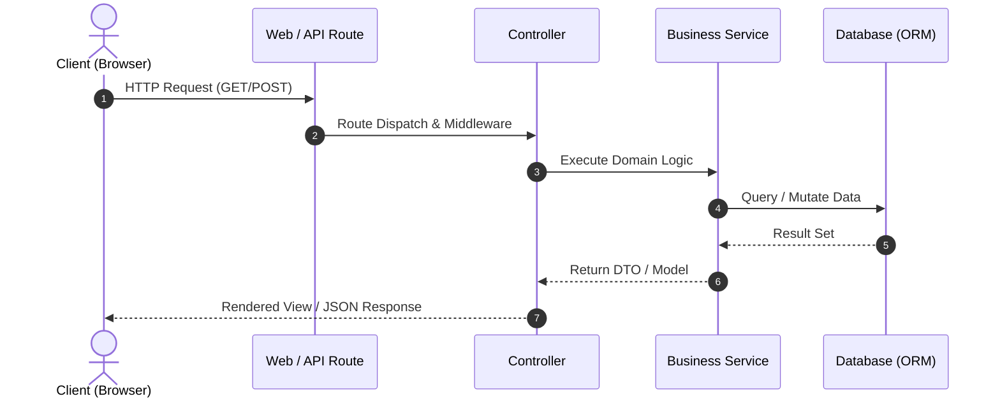

# System Architecture & Technical Design Document

## 1. Architecture Overview
- **System Name**: [System / Application Name]
- **Pattern**: [e.g., MVC, Modular Monolith, Microservices, Jamstack]
- **Hosting / Runtime**: [e.g., Laragon Local / PHP 8.3 / Apache / Nginx / Vercel]

## 2. Technology Stack & Justification
- **Backend**: [e.g., PHP / Laravel 11]
- **Frontend / Templating**: [e.g., Blade + Tailwind CSS + Alpine.js]
- **Database / Cache**: [e.g., MySQL 8.0 / Redis]
- **Build Tools**: [e.g., Vite, Composer, NPM]

## 3. Directory & File Structure
```text
project-root/
├── app/
│   ├── Http/Controllers/
│   ├── Models/
│   └── Services/
├── database/
│   ├── migrations/
│   └── seeders/
├── resources/
│   ├── css/
│   ├── js/
│   └── views/
│       ├── components/
│       └── layouts/
├── routes/
│   ├── web.php
│   └── api.php
└── public/
```

## 4. Data Flow & Sequence Diagram


## 5. Security Architecture
- **Authentication**: [Session-based cookies / JWT tokens]
- **Authorization**: [Role-Based Access Control / Policies / Gates]
- **Data Protection**: Prepared statements, strict validation request classes, output encoding.

## 6. Scalability & Performance Strategy
- Caching layer for expensive database queries.
- Static asset optimization and CDN-ready delivery.
- Asynchronous queuing for emails and heavy background operations.
